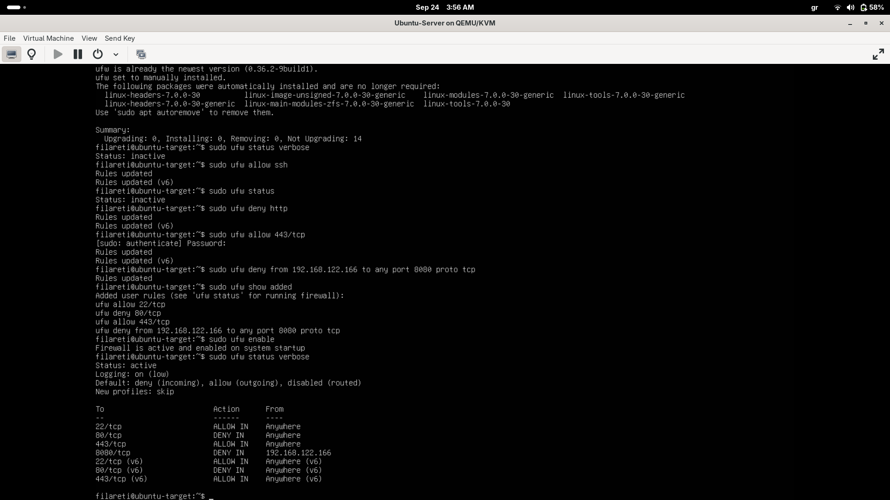
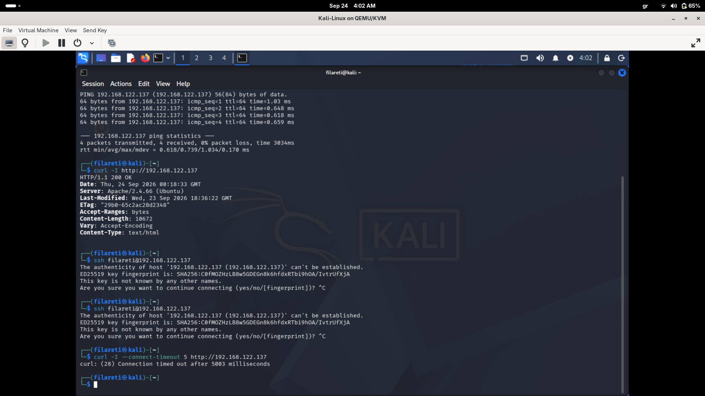
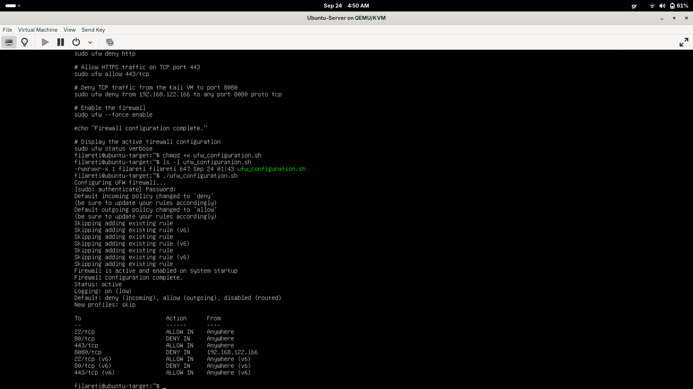

# Task 2 - Basic Firewall Configuration with UFW

## Objective

The objective of this task was to configure a basic firewall on a Linux system using UFW (Uncomplicated Firewall).

The firewall was configured to control incoming network traffic by allowing or denying connections based on ports, services, protocols, and source IP addresses. The configuration was then tested from a separate Kali Linux virtual machine to verify that the firewall rules worked as expected.

---

## Lab Environment

The task was performed in an isolated virtual lab environment using two Linux virtual machines.

- **Firewall / Target Machine:** Ubuntu Server 26.04.1 LTS
- **Ubuntu IP Address:** `192.168.122.137`
- **Testing Machine:** Kali Linux
- **Kali IP Address:** `192.168.122.166`
- **Firewall Tool:** UFW (Uncomplicated Firewall)
- **Virtualization:** QEMU/KVM with libvirt networking

All firewall configuration and testing was performed only on virtual machines under my control.

---

## What is a Firewall?

A firewall is a security mechanism that controls network traffic entering or leaving a system according to a defined set of rules.

Firewall rules can be used to allow legitimate network services while blocking traffic that should not be accessible.

For example, a server administrator may allow remote administration through SSH while blocking an unnecessary web service.

This reduces unnecessary network exposure and helps protect systems from unauthorized access.

---

## What is UFW?

UFW stands for **Uncomplicated Firewall**.

It provides a simplified command-line interface for managing firewall rules on Linux systems. Instead of manually configuring lower-level firewall rules, UFW allows administrators to define policies using commands such as:

```bash
sudo ufw allow ssh
sudo ufw deny http
```

For this task, UFW was used to create and test rules controlling access to several TCP ports.

---

## UFW Installation

UFW was checked and installed using:

```bash
sudo apt install ufw
```

The system reported that UFW was already installed and was the newest available version.

Before configuration, its status was checked with:

```bash
sudo ufw status verbose
```

The firewall was initially inactive.

---

## Firewall Rules

Four firewall rules were configured during this task.

### Rule 1 - Allow SSH Traffic

Command:

```bash
sudo ufw allow ssh
```

This rule allows incoming SSH connections on TCP port 22.

SSH is used for secure remote administration. Allowing this traffic ensures that authorized remote management connections can reach the server.

Result:

```text
22/tcp    ALLOW IN    Anywhere
```

---

### Rule 2 - Deny HTTP Traffic

Command:

```bash
sudo ufw deny http
```

This rule denies incoming HTTP connections on TCP port 80.

Apache was running on the Ubuntu target, which allowed HTTP connectivity to be tested before and after applying the firewall rule.

The purpose of this rule was to demonstrate how a firewall can prevent remote clients from reaching a service even when that service is running on the server.

Result:

```text
80/tcp    DENY IN    Anywhere
```

---

### Rule 3 - Allow HTTPS Traffic

Command:

```bash
sudo ufw allow 443/tcp
```

This additional rule allows incoming TCP connections to port 443, which is commonly used for HTTPS traffic.

This rule demonstrates how a firewall can permit encrypted web traffic while a different rule blocks unencrypted HTTP traffic on port 80.

Result:

```text
443/tcp    ALLOW IN    Anywhere
```

---

### Rule 4 - Deny Kali VM Access to TCP Port 8080

Command:

```bash
sudo ufw deny from 192.168.122.166 to any port 8080 proto tcp
```

This rule blocks TCP traffic to port 8080 specifically when the source address is the Kali Linux VM (`192.168.122.166`).

Unlike a general port rule, this rule demonstrates more specific filtering based on multiple properties:

- Source IP address: `192.168.122.166`
- Destination port: `8080`
- Protocol: TCP
- Action: DENY

Result:

```text
8080/tcp    DENY IN    192.168.122.166
```

This demonstrates that firewall rules can control not only which ports are accessible, but also which systems are permitted or denied access.

---

## Default Firewall Policies

The following default policies were configured:

```bash
sudo ufw default deny incoming
sudo ufw default allow outgoing
```

This creates a basic security policy where unsolicited incoming traffic is denied unless an explicit rule allows it, while outgoing traffic from the Ubuntu system is permitted.

The resulting configuration showed:

```text
Default: deny (incoming), allow (outgoing), disabled (routed)
```

---

## Enabling the Firewall

After configuring the required rules, UFW was enabled using:

```bash
sudo ufw enable
```

The firewall reported:

```text
Firewall is active and enabled on system startup
```

---

## Verifying the Configuration

The active firewall configuration was verified using:

```bash
sudo ufw status verbose
```

The final rules included:

```text
22/tcp     ALLOW IN    Anywhere
80/tcp     DENY IN     Anywhere
443/tcp    ALLOW IN    Anywhere
8080/tcp   DENY IN     192.168.122.166
```

IPv6 equivalents were also automatically created by UFW for the general SSH, HTTP, and HTTPS rules.

---

## Testing the Firewall

Firewall rules should not only be configured but also tested to confirm that they behave as intended.

The Kali Linux VM was used as a separate client to test access to services running on the Ubuntu target.

### HTTP Blocking Test

Before enabling the HTTP deny rule, the Apache web server on Ubuntu was reachable from Kali.

The following command was used from Kali:

```bash
curl -I http://192.168.122.137
```

The server returned:

```text
HTTP/1.1 200 OK
Server: Apache/2.4.66 (Ubuntu)
```

This confirmed that the Apache HTTP service was reachable.

After UFW was enabled with the HTTP deny rule, the test was repeated using:

```bash
curl -I --connect-timeout 5 http://192.168.122.137
```

The result was:

```text
curl: (28) Connection timed out after 5003 milliseconds
```

This demonstrated that the HTTP service was still present on the Ubuntu machine, but incoming access to port 80 from Kali was being blocked by the firewall.

---

### Source-Specific Port 8080 Test

An additional test was performed to verify the source-specific port 8080 rule.

A temporary Python HTTP server was started on the Ubuntu target:

```bash
python3 -m http.server 8080 &
```

The service was first tested locally on Ubuntu:

```bash
curl -I http://127.0.0.1:8080
```

The response included:

```text
HTTP/1.0 200 OK
```

This confirmed that a service was actively listening on port 8080.

The same service was then accessed from the Kali VM:

```bash
curl -I --connect-timeout 5 http://192.168.122.137:8080
```

The result was:

```text
curl: (28) Connection timed out after 5002 milliseconds
```

Because the service responded locally but could not be reached from the Kali source address, this test demonstrated the effect of the source-specific UFW rule:

```text
Kali 192.168.122.166 -> Ubuntu TCP/8080 -> DENY
```

The temporary Python HTTP server was stopped after testing.

---

## UFW Configuration Script

A reusable shell script named:

```text
ufw_configuration.sh
```

was created to apply the firewall configuration automatically.

The script:

1. Sets the default incoming policy to deny.
2. Sets the default outgoing policy to allow.
3. Allows SSH traffic.
4. Denies HTTP traffic.
5. Allows HTTPS traffic.
6. Denies TCP port 8080 traffic from the Kali VM.
7. Enables UFW.
8. Displays the final firewall status.

The script was made executable using:

```bash
chmod +x ufw_configuration.sh
```

and executed using:

```bash
./ufw_configuration.sh
```

When rules already existed, UFW displayed messages such as:

```text
Skipping adding existing rule
```

This indicated that UFW avoided creating duplicate copies of the existing rules.

After execution, the firewall remained active and the expected rules were present.

---

## Screenshots

### Active UFW Rules

The following screenshot shows the active firewall configuration and the configured rules.



### Firewall Testing

The following screenshot shows network testing from the Kali Linux VM, including successful HTTP access before the firewall restriction and the timeout after HTTP traffic was blocked.



### UFW Configuration Script Execution

The following screenshot shows the executable configuration script being run and the resulting active firewall configuration.



---

## Security Analysis

This task demonstrates an important firewall principle: network services should only be accessible when they are actually required.

The configuration follows a restrictive approach for incoming traffic by using:

```text
deny incoming
```

as the default policy and then explicitly allowing required traffic.

The SSH rule demonstrates allowing a required administrative service. The HTTP rule demonstrates blocking access to a running service. The HTTPS rule demonstrates explicitly permitting a selected web port.

The port 8080 rule demonstrates more granular filtering because access is denied according to both the source IP address and destination port.

The tests also demonstrated an important distinction between a service and a firewall rule. A service can be running correctly on a system while a firewall prevents remote clients from reaching it.

---

## Conclusion

In this task, UFW was installed and configured on an Ubuntu Server virtual machine.

Firewall rules were created to allow SSH, deny HTTP, allow HTTPS, and deny TCP port 8080 traffic from a specific Kali Linux VM.

The active rules were verified using `ufw status verbose`, and blocked traffic was tested from a separate machine. A temporary HTTP service was also used to verify source-specific filtering on port 8080.

Finally, the complete firewall configuration was placed in an executable `ufw_configuration.sh` script so that the configuration can be applied in a repeatable way.

All configuration and testing was performed in an isolated virtual lab using systems under my control.
